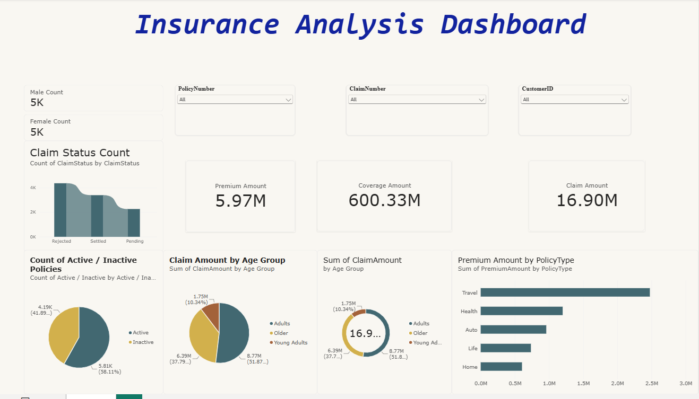
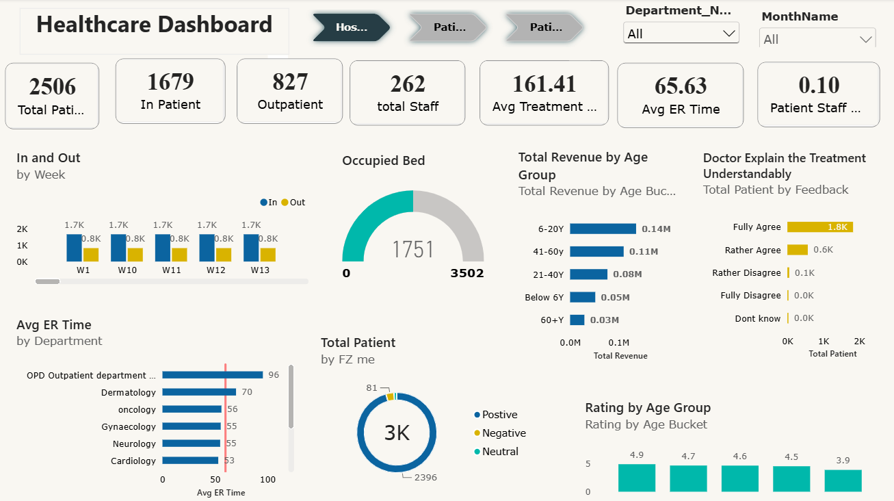

# Power BI Dashboards: Healthcare & Insurance Analytics

Two interactive Power BI dashboards built from raw data using Power Query for cleaning, a star-schema data model, and DAX measures.

## Dashboards

### 1. Insurance Analysis Dashboard


**Questions it answers:** How are claims distributed by status? Which policy types and age groups drive premiums and claim costs? How many policies are still active?

| KPI | Value |
|---|---|
| Total Premium | 5.97M |
| Total Coverage | 600.33M |
| Total Claims | 16.90M |
| Policies Active / Inactive | 5.81K (58%) / 4.19K (42%) |

**Highlights**
- Travel policies generate the most premium (~2.5M), well ahead of Health, Auto, Life and Home.
- Adults (25-60) account for ~52% of claim amount, Older ~38%, Young Adults ~10%.
- Slicers for PolicyNumber, ClaimNumber and CustomerID, plus a drill-through page with record-level detail.

### 2. Healthcare Dashboard


**Questions it answers:** How busy is the hospital, where are ER waits longest, and how satisfied are patients?

| KPI | Value |
|---|---|
| Total Patients | 2,506 (1,679 inpatient / 827 outpatient) |
| Total Staff | 262 |
| Avg Treatment Cost | 161.41 |
| Avg ER Time | 65.63 min |
| Bed Occupancy | 1,751 of 3,502 |

**Highlights**
- Weekly admissions vs. discharges, filterable by department and month.
- Average ER time by department with a reference line (OPD has the longest wait).
- Revenue and rating by age bucket, patient feedback on treatment explanations, and sentiment split.

## Tech & Techniques
- **Power BI Desktop**, **Power Query (M)**, **DAX**
- Data cleaning: null handling, de-duplication, type casting with locale-aware dates, derived columns (Age Group, Active/Inactive)
- Data modelling: fact table with Department, Staff and Bed dimensions, plus a calendar table
- Visuals: KPI cards, ribbon, donut, pie, gauge, bar and drill-through pages

## Repository Structure
```
├── dashboards/   # .pbix files (open in Power BI Desktop)
├── data/         # Source datasets (CSV / XLSX)
├── images/       # Dashboard screenshots
└── docs/         # Step-by-step rebuild guide (M queries, DAX, layout)
```

## How to Use
1. Clone the repo: `git clone https://github.com/VPraja92/powerbi-healthcare-insurance-dashboards.git`
2. Open a `.pbix` from `dashboards/` in Power BI Desktop.
3. If data fails to load: **Home > Transform data > Data source settings > Change Source** and point to the matching file in `data/`.
4. To rebuild from scratch, follow [`docs/PowerBI_Rebuild_Guide.md`](docs/PowerBI_Rebuild_Guide.md).

## Data
Datasets are sample/educational data. Insurance: ~10K policies and claims. Healthcare: ~2.5K patient records across detail, department, staff and bed tables.

## Author
**Vishal Prajapati** · [LinkedIn](https://www.linkedin.com/in/vishal-prajapati-8198653b0) · [GitHub](https://github.com/VPraja92)
